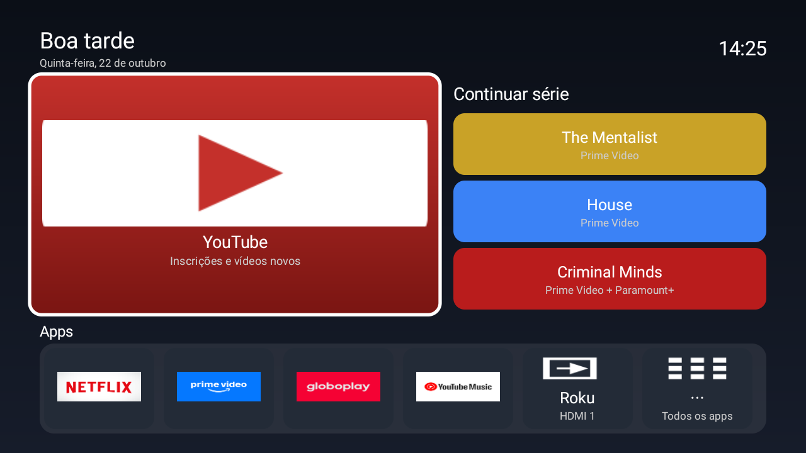

# TCL TV Launcher

Launcher nativo e leve para Android TV (testado numa TCL com Android TV 11, 1280×720, ~1 GB de RAM),
feito para substituir a home do Google TV cheia de propaganda.



## O que faz

- Tela inicial com YouTube em destaque, atalhos grandes e barra de apps com os banners oficiais.
- Botão que troca a TV direto para uma entrada HDMI (ex.: Roku).
- Cartão "Tocando agora" (MediaSession) com play/pause e próxima, só quando há algo tocando.
- Leve: Kotlin + Views, sem rede; ~40–55 MB de memória contra ~115 MB da home do Google.

Inspirado em [Gathin23/cleanyourtv](https://github.com/Gathin23/cleanyourtv).

## Build e instalação

Requer JDK 17 e Android SDK 35.

```sh
./gradlew assembleDebug
export ANDROID_SERIAL=<ip-da-tv>:5555      # adb connect antes, com depuração ativada na TV
adb install -r app/build/outputs/apk/debug/app-debug.apk
adb shell cmd package set-home-activity com.joaofsantos.tcllauncher/.MainActivity
scripts/grant-media-listener.sh            # permissão do "Tocando agora"
```

Em algumas TVs a home do fabricante tem prioridade; nesse caso é preciso desativar
`com.google.android.tvlauncher` (`pm disable-user --user 0`). Nada aqui desinstala apps do sistema.

## Configuração

Apps, ordem e entrada HDMI ficam em `app/src/main/assets/launcher_config.json`.

## Restaurar

`scripts/restore.sh --dry-run --launcher-package com.joaofsantos.tcllauncher` mostra o que seria feito:
reativa os pacotes listados em `backup/debloat-applied.txt` (crie o seu; não versionado aqui),
devolve a home original e remove este launcher.
